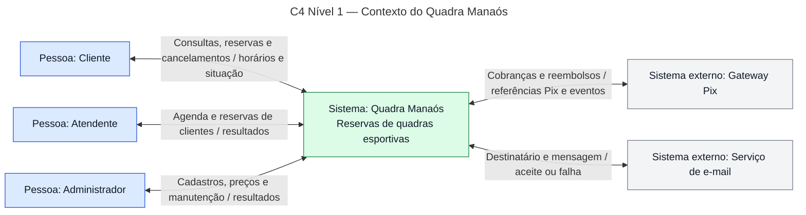
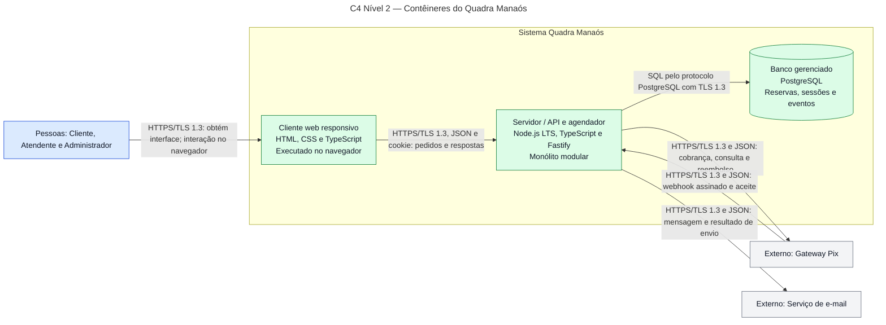
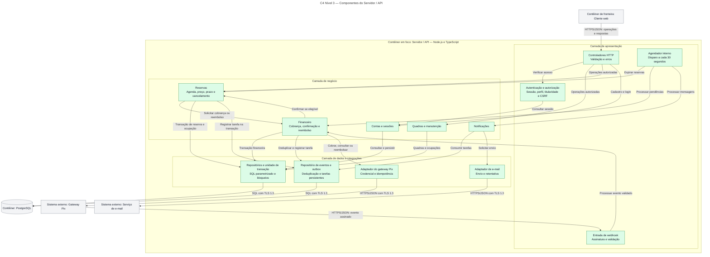
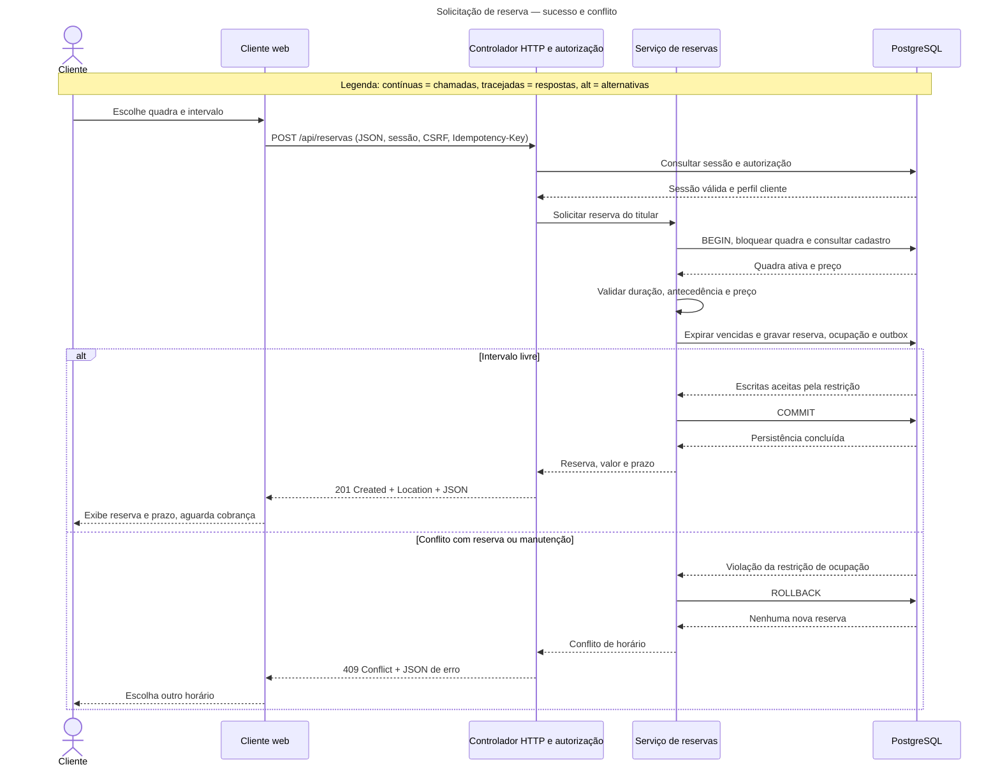

# Quadra Manaós — Requisitos e Arquitetura

**Centro Universitário de Ensino Superior do Amazonas — CIESA**<br>
**Disciplina:** Projetos de Sistemas<br>
**Autor:** Pedro Isaque<br>
**Modalidade:** individual — levantamento, arquitetura e revisão sob responsabilidade do autor<br>
**Data:** 6 de novembro de 2026

> Projeto conceitual, sem programação, conforme o enunciado. Tecnologias, metas e contratos são propostas, não um sistema implantado. As respostas HTTP são ilustrativas; não são resultados de testes.

## Sumário

1. [Descrição e escopo](#1-descrição-e-escopo)
2. [Requisitos funcionais](#2-requisitos-funcionais)
3. [Requisitos não funcionais](#3-requisitos-não-funcionais)
4. [Regras de negócio](#4-regras-de-negócio)
5. [Arquitetura C4](#5-arquitetura-c4)
6. [Registros de decisão — ADRs](#6-registros-de-decisão--adrs)
7. [Comunicação cliente-servidor](#7-comunicação-cliente-servidor)
8. [Rastreabilidade](#8-rastreabilidade)
9. [Cenários de aceitação](#9-cenários-de-aceitação)
10. [Conferência da entrega](#10-conferência-da-entrega)
11. [Referências](#sources)

# Parte 1 — Levantamento de requisitos

## 1. Descrição e escopo

O **Quadra Manaós** é um sistema de reserva de quadras esportivas de um empreendimento fictício de Manaus. O **cliente** consulta quadras, preços e horários livres, solicita reservas, paga via Pix e acompanha ou cancela suas reservas dentro das condições comerciais. O **atendente** consulta a agenda e registra reservas e cancelamentos em nome de clientes identificados. O **administrador** mantém o cadastro de quadras, preços e períodos de manutenção. O objetivo é substituir anotações dispersas por uma agenda única, evitando conflitos de horário e explicitando prazos de antecedência, pagamento e cancelamento.

### 1.1 Escopo e premissas

- Uma unidade com várias quadras; interface web responsiva em português brasileiro.
- Perfis distintos: administrador não recebe implicitamente permissões de atendente. Funcionários podem acumular perfis quando autorizados.
- Pagamento exclusivamente por Pix, por gateway externo; armazenam-se referências financeiras, não credenciais bancárias ou dados de cartão.
- Segundo sistema externo: serviço de e-mail transacional. Fornecedores ficam em aberto, sujeitos às exigências de HTTPS e confirmação financeira autenticada.
- Regras e valores são **premissas do negócio fictício**, não entrevistas realizadas.
- Fora do escopo: aplicativo nativo, campeonatos, mensalidades, múltiplas unidades, reservas recorrentes e dinheiro.
- Apresentação de datas em `America/Manaus`; API em ISO 8601 com deslocamento explícito; armazenamento dos instantes em UTC. Exemplos usam `-04:00`.

### 1.2 Convenções

**RF:** funcionalidade. **RNF:** qualidade mensurável. **RN:** política que valeria mesmo com atendimento em papel. Prioridade **alta** indica necessidade inicial; **média**, suporte relevante; **baixa**, melhoria adiável. Neste recorte, foram selecionados requisitos de prioridade alta ou média.

## 2. Requisitos funcionais

| Código | Tipo | Descrição | Prioridade |
|---|---|---|---|
| RF01 | Funcional | O sistema deve permitir que o cliente crie sua conta informando nome, e-mail e senha. | Alta |
| RF02 | Funcional | O sistema deve permitir que o cliente, o atendente e o administrador iniciem e encerrem uma sessão com suas credenciais. | Alta |
| RF03 | Funcional | O sistema deve permitir que o cliente e o atendente consultem quadras ativas, modalidades e preços por hora. | Alta |
| RF04 | Funcional | O sistema deve permitir que o cliente e o atendente consultem horários disponíveis de uma quadra em uma data. | Alta |
| RF05 | Funcional | O sistema deve permitir que o cliente solicite uma reserva para si, escolhendo quadra, data e intervalo e recebendo valor e prazo de pagamento. | Alta |
| RF06 | Funcional | O sistema deve permitir que o cliente visualize a cobrança Pix da própria reserva e acompanhe a confirmação do pagamento. | Alta |
| RF07 | Funcional | O sistema deve permitir que o cliente consulte suas reservas, seus estados e a situação de pagamentos e reembolsos. | Alta |
| RF08 | Funcional | O sistema deve permitir que o cliente cancele sua própria reserva conforme a política de cancelamento e consulte o reembolso cabível. | Alta |
| RF09 | Funcional | O sistema deve permitir que o administrador cadastre, consulte e atualize nome, modalidade, preço por hora e situação ativa de uma quadra. | Alta |
| RF10 | Funcional | O sistema deve permitir que o administrador registre e remova bloqueios de horários para manutenção. | Alta |
| RF11 | Funcional | O sistema deve permitir que o atendente consulte a agenda diária de todas as quadras com o estado de cada reserva. | Alta |
| RF12 | Funcional | O sistema deve permitir que o atendente registre uma reserva em nome de um cliente cadastrado, sujeita às mesmas regras de horário e pagamento. | Alta |
| RF13 | Funcional | O sistema deve permitir que o atendente cancele uma reserva de cliente, registrando o motivo e respeitando a política de cancelamento. | Média |
| RF14 | Funcional | O sistema deve permitir que o cliente receba e-mails de confirmação de reserva, expiração e cancelamento, com referência e situação financeira. | Média |

## 3. Requisitos não funcionais

São **metas propostas**, não medições realizadas. Ambiente de referência: 10 quadras, 10 mil reservas e carga de 100 usuários simultâneos por 15 minutos. Tempos da API são medidos na entrada e saída do servidor, sem incluir tempo humano de pagamento.

| Código | Tipo / categoria | Descrição mensurável e verificação | Prioridade |
|---|---|---|---|
| RNF01 | Não funcional / desempenho | Pelo menos 95% das consultas de disponibilidade devem responder em até 2 segundos no ambiente de referência, com taxa de erros 5xx inferior a 1%. Verificação: teste de carga e percentil 95. | Alta |
| RNF02 | Não funcional / segurança de acesso | 100% das operações protegidas devem exigir sessão e autorização por perfil e, quando aplicável, titularidade; após 5 falhas de login de uma conta em 15 minutos, novas tentativas dessa conta devem ser bloqueadas por 15 minutos. Verificação: testes de acesso e dos limites de login. | Alta |
| RNF03 | Não funcional / segurança de transporte | 100% das conexões de produção navegador-servidor e servidor-serviços externos devem usar HTTPS com TLS 1.3; servidor-banco deve exigir TLS 1.3. Nenhuma senha ou identificador de sessão deve constar nos logs. Verificação: inspeção de conexões e logs de teste. | Alta |
| RNF04 | Não funcional / disponibilidade | Aplicação web e API devem ter disponibilidade mensal mínima de 99,5%, medida por sonda externa a cada 60 segundos, incluindo manutenção no cálculo. Falhas de terceiros devem ser registradas separadamente e não podem impedir a consulta local da agenda. | Alta |
| RNF05 | Não funcional / usabilidade e acessibilidade | Login, consulta, reserva e cancelamento devem atender a todos os critérios aplicáveis A e AA da WCAG 2.2; pelo menos 4 de 5 participantes representativos devem concluir consulta e solicitação sem ajuda em até 3 minutos, excluindo espera pelo Pix. Verificação: auditoria automática/manual, teclado/leitor de tela e avaliação planejada. | Alta |
| RNF06 | Não funcional / compatibilidade | Fluxos principais devem funcionar nas duas versões estáveis mais recentes de Chrome, Edge e Firefox na homologação, em larguras de 360, 768 e 1366 pixels, sem rolagem horizontal da página. Verificação: matriz por navegador, versão e largura. | Média |
| RNF07 | Não funcional / integridade e concorrência | Em 100 tentativas concorrentes para o mesmo intervalo de uma quadra livre, exatamente 1 deve criar a ocupação e 99 devem receber conflito, sem duplicidade. Verificação: ensaio com identidades e chaves de idempotência distintas. | Alta |
| RNF08 | Não funcional / recuperação | Perda de dados de no máximo 15 minutos (RPO) e restauração do serviço em até 2 horas (RTO), verificadas por simulação trimestral de restauração de backup e registros de transações. | Alta |
| RNF09 | Não funcional / confiabilidade de integração | Um evento financeiro recebido 10 vezes deve gerar uma única alteração financeira. Expiração e processamento local de evento válido devem ocorrer em até 60 segundos após prazo ou recebimento, respectivamente, com API e banco disponíveis. Verificação: reenvio, relógio controlado e histórico. | Alta |

A WCAG 2.2 é a referência de acessibilidade de RNF05.[4] As demais metas são escolhas deste projeto, não derivadas dessa norma.

## 4. Regras de negócio

| Código | Tipo | Política comercial | Prioridade |
|---|---|---|---|
| RN01 | Regra de negócio | Uma quadra não pode ser cedida a duas reservas nem a reserva e manutenção em intervalos sobrepostos. Intervalos incluem o início e excluem o fim: 18h–19h não conflita com 19h–20h. | Alta |
| RN02 | Regra de negócio | A unidade funciona diariamente das 08h às 23h em Manaus; reservas começam em hora cheia, duram de 1 a 3 horas inteiras e terminam até as 23h do mesmo dia. | Alta |
| RN03 | Regra de negócio | Nova reserva só pode começar entre 2 horas e 30 dias de antecedência da solicitação, incluindo os limites. | Alta |
| RN04 | Regra de negócio | O valor é o preço por hora vigente na solicitação multiplicado pela duração. Alterações posteriores de tarifa não mudam reservas existentes. | Alta |
| RN05 | Regra de negócio | Pagamento integral em até 15 minutos da solicitação. O horário fica retido nesse prazo; sem confirmação até o limite, a reserva expira e o horário é liberado. | Alta |
| RN06 | Regra de negócio | Cliente ou atendente só pode cancelar reserva pendente ou confirmada com antecedência mínima de 24 horas. Cancelamento elegível libera o horário e dá direito a reembolso integral se já pago, sem multa. | Alta |
| RN07 | Regra de negócio | Com menos de 24 horas de antecedência, não há cancelamento pelo cliente ou atendente; ausência não dá direito a reembolso. | Alta |
| RN08 | Regra de negócio | Reservas de balcão obedecem às mesmas condições de preço, antecedência, pagamento e cancelamento das feitas pelo cliente. | Alta |
| RN09 | Regra de negócio | Pagamento confirmado após o prazo ou para reserva cancelada/expirada não recupera o direito ao horário e deve ser integralmente reembolsado. | Alta |

**Limites:** reservar entre 2 e menos de 24 horas antes do início implica não poder cancelar, mas ainda há expiração por falta de pagamento. A confirmação válida deve chegar até `expiraEm`, inclusive. Não existe exceção administrativa de cancelamento neste recorte.

# Parte 2 — Documento de arquitetura

## 5. Arquitetura C4

Propõe-se arquitetura **cliente-servidor**, cliente web, API em monólito modular e banco relacional. Os três níveis C4 — contexto, contêineres e componentes — são representados com Mermaid `flowchart`, preservando suas abstrações.[1] Não há nível de código nesta entrega conceitual.

### 5.1 Nível 1 — Contexto do Quadra Manaós

O sistema é uma caixa única; não se mostram banco ou módulos internos.



**Legenda:** azul = pessoa/perfil; verde = sistema em estudo; cinza = sistema externo. Setas bidirecionais representam ida e volta; nas legendas, `/` separa o conteúdo enviado do conteúdo retornado, tomando o elemento à esquerda como origem. **Requisitos:** RF01–RF14; gateway atende RF06/RF08/RN09; e-mail atende RF14.

### 5.2 Nível 2 — Contêineres do Quadra Manaós

Contêiner é abstração C4, não exigência de Docker. API e agendador pertencem à mesma aplicação; front-end é distribuído como arquivos estáticos.



**Legenda:** azul = usuários; verde = contêiner do sistema; cinza = externo; cilindro = armazenamento. Setas indicam protocolo e conteúdo; respostas voltam pela conexão original. Webhook é iniciado pelo gateway. **Requisitos/decisões:** RNF01–RNF09; ADR-001/ADR-002/ADR-003.

### 5.3 Nível 3 — Componentes do contêiner Servidor / API

Somente o servidor é expandido. Todos os componentes internos são TypeScript e comunicam-se em processo, não como microserviços.



**Legenda:** verde = componente interno; cinza = contêiner/sistema fora do recorte; subgrupos = camadas; setas = dependências e conteúdo. Chamadas internas são locais; as de fronteira usam os protocolos indicados. **Requisitos:** contas → RF01/RF02; quadras → RF03/RF09/RF10; reservas → RF04/RF05/RF07/RF08/RF11/RF12/RF13; financeiro → RF06/RN05/RN09; notificações → RF14; autorização → RNF02; repositórios → RNF01/RNF07/RNF08; agendador/outbox → RNF04/RNF09.

### 5.4 Consistência e estados

- **Reserva:** `PENDENTE_PAGAMENTO` → `CONFIRMADA` por confirmação válida no prazo; `PENDENTE_PAGAMENTO` → `EXPIRADA` após prazo; pendente ou confirmada → `CANCELADA` se RN06 permitir. Estado terminal não volta a confirmado.
- **Financeiro separado:** `AGUARDANDO_PAGAMENTO`, `PAGO`, `REEMBOLSO_PENDENTE`, `REEMBOLSADO`. Cancelar não significa concluir o reembolso externo.
- **Concorrência:** reservas ativas e manutenções compartilham relação de ocupações. Propõe-se restrição de exclusão por quadra e intervalo `tstzrange` com limites `[)`, usando `btree_gist`, para impedir sobreposições no banco.[2]
- **Atomicidade:** criação confirma reserva, ocupação, preço e tarefa de cobrança numa transação. Cancelamento/expiração liberam ocupação e persistem tarefas atomicamente. Alterações bloqueiam a linha da reserva. Colisão de ocupação vira HTTP 409.
- **Prazos:** agendador a cada 30 segundos; a API também expira pendências vencidas antes de consultar ou ocupar. Confirmação revalida prazo sob o mesmo bloqueio da expiração. O processamento segue RNF09.
- **Pagamento:** servidor deriva titular/preço; retorno visual do gateway não confirma pagamento. Evento exige assinatura e conferência de referência, valor, moeda e estado; ID único é persistido. Reserva inelegível gera reembolso sem reocupação.
- **Falhas externas:** chamadas externas ficam fora da transação SQL. A outbox do PostgreSQL mantém tarefas; agendador retenta com mesma chave externa de idempotência a cada 30 segundos. Após 10 falhas consecutivas, gera alerta operacional, sem descartar a tarefa. Consultar agenda não chama terceiros.
- **Cobrança assíncrona:** a criação retorna identificador e prazo após commit local. RF06/RF07 apresentam a cobrança quando disponível. A espera externa não estende os 15 minutos.
- **Manutenção/cadastro:** bloqueio conflitante é recusado, não cancela reservas. Desativar quadra impede novas reservas sem apagar as existentes. Cadastro e criação de reserva bloqueiam a linha da quadra para revalidar situação/preço de forma serializada.

## 6. Registros de decisão — ADRs

Os registros estão **aceitos para o projeto conceitual**, sem pressupor implantação. Os RNFs deverão ser medidos em homologação.

### ADR-001 — Adotar cliente web responsivo e API em monólito modular

**Data:** 2026-11-06<br>
**Status:** aceita

#### Contexto

RF03–RF13 exigem agenda compartilhada; RNF01 exige consulta com p95 até 2 segundos; RNF04 exige 99,5% de disponibilidade; RNF05/RNF06 exigem acessibilidade e compatibilidade. Há uma unidade e escopo limitado.

#### Alternativas consideradas

**Alternativa A — Web responsiva e API em monólito modular**

- A favor: sem instalação, uma interface para três perfis, correção centralizada e menos processos.
- Contra: depende de internet/navegador; módulos compartilham implantação e falhas.

**Alternativa B — Aplicativos Android/iOS e API em microserviços**

- A favor: recursos nativos do dispositivo e serviços implantáveis separadamente.
- Contra: múltiplos clientes, lojas e complexidade de comunicação/consistência desproporcional a uma unidade.

#### Decisão

Escolhemos **A**, com HTML/CSS/TypeScript e Node.js LTS/TypeScript/Fastify. Hospedagem em nuvem gerenciada, arquivos estáticos e banco em rede privada. Sondas a cada 60 segundos, reinício automático, alertas e implantação com verificação de saúde visam RNF04. HTML semântico, foco, teclado e layout responsivo visam RNF05/RNF06, sujeitos à auditoria. Consulta local com índices e sem chamadas externas visa RNF01.

#### Consequências

- **Positivas:** menos unidades operacionais, agenda central e atualização sem instalar aplicativo.
- **Negativas:** falha da API afeta vários módulos; custo recorrente; sem uso offline. Plataforma e dimensionamento não garantem, sozinhos, RNF01/RNF04.

### ADR-002 — Usar PostgreSQL e transações para agenda e eventos persistentes

**Data:** 2026-11-06<br>
**Status:** aceita

#### Contexto

RN01 proíbe sobreposição; RN04 fixa preço; RN05/RN09 coordenam expiração/pagamento. RNF07 exige ocupação única; RNF08 exige RPO de 15 minutos e RTO de 2 horas; RNF09 exige deduplicação. Consultar antes de gravar não impede corrida.

#### Alternativas consideradas

**Alternativa A — PostgreSQL, transações, restrição de exclusão e outbox**

- A favor: atomicidade de reserva/ocupação/evento; restrição no banco; relações e histórico verificáveis.
- Contra: exige SQL, desenho de bloqueios e suporte a `btree_gist`.

**Alternativa B — Banco documental com consulta prévia e validação na aplicação**

- A favor: documentos flexíveis e integração simples com objetos.
- Contra: consulta prévia não impede corrida; exige transações ou exclusão adicional para garantir a agenda.

#### Decisão

Escolhemos **A**. Ocupações usam exclusão por quadra e intervalo, mecanismo suportado pelo PostgreSQL para períodos não sobrepostos.[2] Reserva/preço/outbox são atômicos; eventos têm ID único; criação tem chave de idempotência por usuário/conteúdo; confirmar, expirar e cancelar bloqueiam a reserva. Atende ao desenho de RNF07/RNF09 e RN01/RN04/RN05/RN09.

Para RNF08, exigir do serviço backup diário, arquivamento contínuo de registros de transações com atraso máximo de 15 minutos, cópias protegidas e restauração pontual. Ensaio trimestral comprova RPO/RTO, incluindo retomada da API. Backup não substitui disponibilidade nem prova sozinho o prazo de recuperação.

#### Consequências

- **Positivas:** regra da agenda independe da tela; consistência; tarefas sobrevivem a reinícios.
- **Negativas:** dependência do banco; manutenção de índices/outbox; menor portabilidade por extensão/restrição. Backup custa e exige teste. Não manter transação aberta em chamada externa.

### ADR-003 — Adotar sessão de servidor, HTTPS e confirmação financeira autenticada

**Data:** 2026-11-06<br>
**Status:** aceita

#### Contexto

RF02 exige login; RF07/RF08 limitam ao titular; RF09/RF10, ao administrador. RNF02 exige autorização e limite de tentativas; RNF03 protege transporte/logs; RNF09 deduplica eventos. Navegador não é prova de pagamento.

#### Alternativas consideradas

**Alternativa A — Sessão opaca no servidor com cookie protegido**

- A favor: revogação imediata, autorização central e identificador inacessível ao JavaScript.
- Contra: armazenamento/consulta de sessão e prevenção de CSRF.

**Alternativa B — JWT de longa duração no navegador**

- A favor: validação local de assinatura e menor dependência de consulta de sessão.
- Contra: revogação difícil; risco de roubo por script se acessível ao JavaScript; mudança de perfil exige mecanismos adicionais.

#### Decisão

Escolhemos **A**. Sessão no PostgreSQL; cookie `Secure`, `HttpOnly`, `SameSite=Lax`; mesma origem para cliente/API. Rotação no login, expiração após 30 minutos inativos e limite absoluto de 8 horas; logout invalida a sessão. Autorização por perfil/titularidade no servidor; operações modificadoras exigem token CSRF e origem autorizada. Hash Argon2id com salt individual para senhas; tentativas seguem RNF02.

Conexões de produção exigem TLS 1.3 com certificado validado; logs excluem segredos. Webhook exige assinatura e janela de autenticidade do contrato do fornecedor; deduplicação trata reenvios válidos. TLS protege canal, não substitui conferência financeira.[5]

#### Consequências

- **Positivas:** sessão revogável; autorização independente da interface; confirmação sem confiar no cliente.
- **Negativas:** falha no banco de sessões bloqueia operações autenticadas; certificados/segredos/CSRF exigem manutenção; TLS 1.3 restringe fornecedores. TLS não substitui autorização nem protege dispositivo comprometido.

## 7. Comunicação cliente-servidor

### 7.1 Sequência — Solicitar uma reserva

Cliente autenticado solicita horário; servidor valida, persiste ou recusa e responde. Pagamento é posterior e não integra esta transação SQL.



**Legenda complementar:** `alt` indica resultados mutuamente exclusivos. Sessão inválida é recusada antes da reserva; detalha-se o caso autenticado. **Rastreabilidade:** RF02/RF04/RF05; RN01–RN05; RNF02/RNF07; ADR-002/ADR-003.

### 7.2 Contratos HTTP

São **propostas ilustrativas**, não respostas de API executada. Métodos e status seguem a semântica HTTP.[3]

- Origem fictícia: `https://quadra-manaos.example`, não aplicação publicada.
- JSON usa `Content-Type: application/json`; cliente aceita `application/json`.
- As quatro operações exigem sessão; POST/PUT/DELETE exigem CSRF. Sem sessão: 401; sem permissão/titularidade: 403; dados inválidos: 422; recurso inexistente: 404.
- Cliente não escolhe preço, não confirma pagamento nem informa perfil de autorização.
- Dinheiro em centavos inteiros de real: `15000` = R$ 150,00.
- Exemplos 1/2 ocorrem em **2026-11-06 às 10h de Manaus**; exemplo 4, no mesmo dia às 11h, após pagamento confirmado no prazo.
- Detalham-se quatro requisições exigidas, não toda a API. Chamadas internas e conexões de integração dos diagramas não são contratos HTTP adicionais.

#### HTTP-01 — Consultar disponibilidade (GET)

**RF:** RF04. **Perfil:** cliente ou atendente. **Resposta:** 200 OK.

```http
GET /api/quadras/q01/disponibilidade?data=2026-11-10 HTTP/1.1
Host: quadra-manaos.example
Accept: application/json
Cookie: sessao=identificador-opaco-de-exemplo
```

**JSON devolvido — 200 OK:**

```json
{
  "quadraId": "q01",
  "data": "2026-11-10",
  "fusoHorario": "America/Manaus",
  "precoHoraCentavos": 15000,
  "moeda": "BRL",
  "horariosLivres": [
    {"inicio": "2026-11-10T18:00:00-04:00", "fim": "2026-11-10T19:00:00-04:00"},
    {"inicio": "2026-11-10T19:00:00-04:00", "fim": "2026-11-10T20:00:00-04:00"}
  ]
}
```

Consulta não retém horário. Retornam-se intervalos dentro de RN02/RN03 e fora das ocupações ativas.

#### HTTP-02 — Criar reserva (POST), incluindo conflito

**RF:** RF05. **Perfil:** cliente para si. **Resposta:** 201 Created; cabeçalho `Location: /api/reservas/r001`.

```http
POST /api/reservas HTTP/1.1
Host: quadra-manaos.example
Accept: application/json
Content-Type: application/json
Cookie: sessao=identificador-opaco-de-exemplo
X-CSRF-Token: token-csrf-de-exemplo
Idempotency-Key: solicitacao-cliente-001

{
  "quadraId": "q01",
  "inicio": "2026-11-10T18:00:00-04:00",
  "fim": "2026-11-10T19:00:00-04:00"
}
```

**JSON devolvido — 201 Created:**

```json
{
  "id": "r001",
  "quadraId": "q01",
  "inicio": "2026-11-10T18:00:00-04:00",
  "fim": "2026-11-10T19:00:00-04:00",
  "valorCentavos": 15000,
  "moeda": "BRL",
  "status": "PENDENTE_PAGAMENTO",
  "situacaoFinanceira": "AGUARDANDO_PAGAMENTO",
  "criadaEm": "2026-11-06T10:00:00-04:00",
  "expiraEm": "2026-11-06T10:15:00-04:00",
  "cobrancaStatus": "EM_PROCESSAMENTO"
}
```

**Erro da mesma operação:** outra solicitação, com outra chave, tenta o mesmo intervalo enquanto `r001` o retém. **JSON devolvido — 409 Conflict:**

```json
{
  "erro": {
    "codigo": "HORARIO_INDISPONIVEL",
    "mensagem": "A quadra ja possui reserva ou manutencao neste intervalo.",
    "quadraId": "q01",
    "inicio": "2026-11-10T18:00:00-04:00",
    "fim": "2026-11-10T19:00:00-04:00"
  }
}
```

Repetir chave original, conteúdo e titular devolve resposta original sem duplicar reserva. Chave com outro conteúdo gera 409, código `CHAVE_IDEMPOTENCIA_REUTILIZADA`. Retenção proposta: 24 horas.

#### HTTP-03 — Substituir cadastro da quadra (PUT)

**RF:** RF09. **Perfil:** administrador. **Resposta:** 200 OK. Recurso existente; substituem-se todos os campos editáveis, sem mudar reservas/preços anteriores.

```http
PUT /api/quadras/q01 HTTP/1.1
Host: quadra-manaos.example
Accept: application/json
Content-Type: application/json
Cookie: sessao=identificador-opaco-administrador
X-CSRF-Token: token-csrf-de-exemplo

{
  "nome": "Quadra Manaos 1",
  "modalidade": "FUTSAL",
  "precoHoraCentavos": 16000,
  "ativa": true
}
```

**JSON devolvido — 200 OK:**

```json
{
  "id": "q01",
  "nome": "Quadra Manaos 1",
  "modalidade": "FUTSAL",
  "precoHoraCentavos": 16000,
  "moeda": "BRL",
  "ativa": true
}
```

`r001` continua valendo 15000 centavos (RN04). Repetir a representação não cria quadra nem aumenta preço novamente.

#### HTTP-04 — Cancelar reserva (DELETE)

**RF:** RF08. **Perfil:** titular. **Resposta:** 200 OK. Cancelamento lógico: remove da agenda ativa, mas preserva histórico financeiro. Repetir não abre novo reembolso, preservando a idempotência de DELETE.[3]

```http
DELETE /api/reservas/r001 HTTP/1.1
Host: quadra-manaos.example
Accept: application/json
Cookie: sessao=identificador-opaco-de-exemplo
X-CSRF-Token: token-csrf-de-exemplo
```

**JSON devolvido — 200 OK:**

```json
{
  "id": "r001",
  "status": "CANCELADA",
  "canceladaEm": "2026-11-06T11:00:00-04:00",
  "horarioLiberado": true,
  "reembolso": {
    "status": "REEMBOLSO_PENDENTE",
    "valorCentavos": 15000,
    "moeda": "BRL"
  }
}
```

Neste exemplo, pagamento ocorreu dentro dos 15 minutos; cancelamento com mais de 24 horas dá direito a reembolso integral. Resposta indica solicitação, não conclusão externa. A menos de 24 horas, a operação retorna 409, código `PRAZO_CANCELAMENTO_ENCERRADO`, sem alterar estado/ocupação.

### 7.3 HTTPS e dados protegidos

**Proteger:** nome/e-mail, senha em trânsito, hash em repouso, cookie, agenda identificada, histórico, referências Pix, eventos financeiros, segredos e tokens CSRF. Disponibilidade não expõe dados de outros clientes.

**Garantias:** com certificado validado e configuração correta, TLS protege confidencialidade/integridade em trânsito e autentica o servidor. Não se pressupõe certificado de cliente: usuários usam sessão; eventos, assinatura.[5]

**Limites:** TLS não decide permissão de cancelamento, não comprova sozinho pagamento e não substitui hash/autorização nem protege após descriptografia nos terminais. ADR-003 combina transporte com autorização, CSRF, logs sem segredos e conferência financeira.[5]

## 8. Rastreabilidade

### 8.1 Cada RNF ligado à arquitetura

| RNF | Decisão / elemento C4 | Resposta ao requisito | Verificação planejada |
|---|---|---|---|
| RNF01 | ADR-001/ADR-002; N2 API/banco; N3 reservas/repositórios | Consulta local, índices e dimensionamento. | Carga de referência; p95 até 2 s; 5xx abaixo de 1%. |
| RNF02 | ADR-003; N3 autenticação/contas/controladores | Sessão, perfil, titularidade, CSRF e limite de tentativas. | Testar operações protegidas e bloqueio após 5 falhas. |
| RNF03 | ADR-003; conexões N2 e adaptadores N3 | TLS 1.3, certificado e logs sem segredos. | Inspecionar conexões/logs. |
| RNF04 | ADR-001; N2 web/API/banco; N3 outbox | Sondas, reinício e consulta sem terceiros. | Sondas de 60 s; cálculo mensal incluindo manutenção. |
| RNF05 | ADR-001; N2 cliente web | HTML semântico, teclado, foco e layout. | WCAG A/AA e avaliação com 5 participantes. |
| RNF06 | ADR-001; N2 cliente web | Interface responsiva. | Duas versões de três navegadores e três larguras. |
| RNF07 | ADR-002; N3 reservas/repositórios; N2 banco | Exclusão e transações. | 100 tentativas: 1 sucesso, 99 conflitos. |
| RNF08 | ADR-002; N2 banco gerenciado | Backup e restauração pontual. | Ensaio trimestral de RPO/RTO. |
| RNF09 | ADR-002/ADR-003; N3 financeiro/webhook/agendador/outbox | Eventos únicos, bloqueios e tarefas persistentes. | 10 reenvios; expiração/processamento em 60 s. |

### 8.2 Cada requisição HTTP ligada a RF

| Contrato | Método e URL relativa | RF | Resposta detalhada | Regras |
|---|---|---|---|---|
| HTTP-01 | `GET /api/quadras/q01/disponibilidade?data=2026-11-10` | RF04 | 200 com horários. | RN01/RN02/RN03/RN05 |
| HTTP-02 | `POST /api/reservas` | RF05 | 201 com reserva; alternativa 409 com conflito. | RN01/RN02/RN03/RN04/RN05 |
| HTTP-03 | `PUT /api/quadras/q01` | RF09 | 200 com cadastro. | RN04 |
| HTTP-04 | `DELETE /api/reservas/r001` | RF08 | 200 com cancelamento e reembolso pendente. | RN06/RN07/RN09 |

### 8.3 Cobertura funcional e das regras

| Requisitos | Componentes / decisões |
|---|---|
| RF01, RF02 | Contas, autenticação e repositórios; ADR-003. |
| RF03, RF09, RF10 | Quadras/manutenção e repositórios; ADR-001/ADR-002. |
| RF04, RF05, RF07, RF11, RF12 | Reservas, quadras, autorização e repositórios; ADR-001/ADR-002/ADR-003. |
| RF06 | Financeiro, webhook e adaptador Pix; ADR-002/ADR-003. |
| RF08, RF13 | Reservas, autorização e financeiro; ADR-002/ADR-003. |
| RF14 | Outbox, agendador, notificações e adaptador e-mail; ADR-001/ADR-002. |
| RN01 | Restrição de ocupação e transações; ADR-002. |
| RN02, RN03 | Validação de reservas no horário de Manaus; ADR-001/ADR-002. |
| RN04 | Preço fixado na transação; ADR-002. |
| RN05 | Ocupação pendente, expiração/confirmação sob bloqueio; ADR-002. |
| RN06, RN07 | Reservas valida elegibilidade; financeiro registra reembolso devido; ADR-002. |
| RN08 | Mesmo serviço de reservas com perfis distintos; ADR-001/ADR-003. |
| RN09 | Financeiro não reativa vencida/cancelada e persiste reembolso; ADR-002/ADR-003. |

## 9. Cenários de aceitação

Roteiros para futura implementação. **Não são alegados testes de aplicação, carga, acessibilidade ou avaliação com participantes como executados neste trabalho conceitual.**

| Cenário | Condição / ação | Esperado |
|---|---|---|
| Concorrência | 100 clientes tentam mesmo intervalo com chaves distintas. | Uma ocupação; 99 conflitos; sem cobrança para recusadas (RN01/RNF07). |
| Adjacência | Existente 18h–19h; solicitar 19h–20h. | Permitido se demais regras atendidas (RN01). |
| Horário | Solicitar 22h–23h, 23h–00h e 18h30–19h30. | Primeiro elegível; demais recusados (RN02). |
| Antecedência | Relógio controlado: 1h59, 2h, 30 dias e 30 dias mais 1 minuto. | Recusar primeiro/último; limites elegíveis se no funcionamento (RN03). |
| Preço | Reservar por R$ 150; mudar tarifa para R$ 160. | Existente mantém R$ 150; novas usam R$ 160 (RN04). |
| Expiração | Não pagar; avançar além dos 15 minutos. | Expirada, horário liberado na meta e e-mail enfileirado (RN05/RNF09/RF14). |
| Cancelamento | Cancelar paga a exatamente 24h; repetir; comparar com 23h59. | Um cancelamento/reembolso no primeiro caso; recusa no segundo (RN06/RN07). |
| Tardio | Confirmação após prazo ou cancelamento. | Sem reocupação; reembolso integral (RN09). |
| Duplicidade | Mesmo evento válido 10 vezes. | Uma alteração financeira (RNF09). |
| Acesso | Cliente tenta reserva alheia ou cadastro de quadra. | Negado sem exposição/alteração (RNF02). |
| Manutenção | Bloquear intervalo ocupado e outro livre. | Primeiro recusado; segundo impede novas reservas (RF10/RN01). |
| Falha externa | Gateway/e-mail indisponíveis durante consulta. | Agenda funciona; tarefas persistem (RNF04). |

## 10. Conferência da entrega

| Exigência | Atendimento |
|---|---|
| Descrição e usuários | Seção 1; cliente, atendente e administrador. |
| Mínimo 10 RF, com código, formato e prioridade | 14 RF na seção 2. |
| Mínimo 6 RNF mensuráveis em 4 categorias | 9 RNF na seção 3: desempenho, segurança, disponibilidade, acessibilidade/usabilidade, compatibilidade, integridade e recuperação. |
| Mínimo 5 RN, com código e prioridade | 9 políticas na seção 4. |
| C4 níveis 1 a 3, títulos e legendas | Três diagramas Mermaid na seção 5. |
| Dois externos; tecnologias/protocolos no N2; camadas no N3 | Gateway Pix, e-mail e diagramas 5.2/5.3. |
| Três ADRs com alternativas, requisitos e consequências negativas | Seção 6. |
| Sequência cliente → servidor → banco → resposta | Seção 7.1. |
| Quatro requisições com URL, método, status, JSON e erro 4xx | GET/POST/PUT/DELETE, com 409 detalhado, na seção 7.2. |
| HTTPS e proteção | Seção 7.3/ADR-003. |
| RNFs e requisições sem lacunas de rastreabilidade | Seções 8.1/8.2; cobertura adicional em 8.3. |
| Único Markdown e Mermaid interno | Toda a entrega neste README, sem imagens ou aplicação. |
| Contribuição individual no histórico | Autor identificado; entrega registrada sob identidade Git de Pedro Isaque. |


## Sources

[1] https://c4model.com/diagrams
[2] https://www.postgresql.org/docs/current/rangetypes.html
[3] https://www.rfc-editor.org/rfc/rfc9110
[4] https://www.w3.org/TR/WCAG22
[5] https://www.rfc-editor.org/rfc/rfc9846
